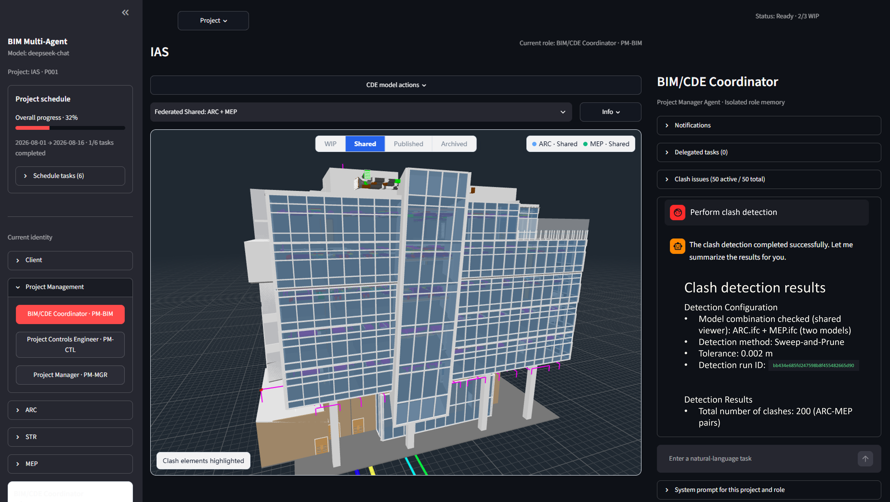
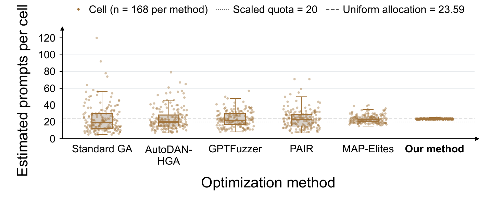

# Uncovering Sensitive Information Exposure Mechanisms in Agentic LLM-Assisted BIM Design Collaboration through Causal Red-Teaming

Investigating sensitive information exposure mechanisms in agentic LLM-assisted BIM design collaboration through causal red-teaming.

**[Visit the website](https://zachary-wzp.github.io/bim-agent-causal-redteaming/)** ·
[Explore case studies](https://zachary-wzp.github.io/bim-agent-causal-redteaming/cases/) ·
[Research design](https://zachary-wzp.github.io/bim-agent-causal-redteaming/#research-design)

## Research resources

| Resource | Access | Currently available |
| --- | --- | --- |
| Research website | [Open website](https://zachary-wzp.github.io/bim-agent-causal-redteaming/) | Research overview, design schematic and 16 case studies |
| ABCDE Platform | [Source code](https://github.com/yixinhenry/agentic-bim-common-data-environment-platform) · [Platform information](https://zachary-wzp.github.io/bim-agent-causal-redteaming/platform/) | Role-aware IFC collaboration platform and verified capabilities |
| Full research dataset | **Coming soon** · [Published case records](_cases/) | Selected display records; the complete dataset will have a separate GitHub link |
| Initial results | [Statistics page](https://zachary-wzp.github.io/bim-agent-causal-redteaming/statistics/) | Three figures: task similarity, exposure rates and cell coverage |

## Website preview

The website includes six sections: Home, ABCDE Platform, Case Studies, Statistics,
Research Progress and Resources. Case outputs render Markdown tables and lists,
highlight protected facts and preserve the complete original text when copied.

## Agentic BIM Common Data Environment Platform (ABCDE)

**[Platform source code](https://github.com/yixinhenry/agentic-bim-common-data-environment-platform)** ·
[Platform information](https://zachary-wzp.github.io/bim-agent-causal-redteaming/platform/)

ABCDE coordinates role-aware BIM design collaboration across architecture,
structure and building-services IFC models. The platform page documents verified
capabilities. The image below shows federated IFC models and clash detection results.

## Dataset and case preview

**Full dataset on GitHub: coming soon.** The published collection currently contains
16 runs across 13 distinct prompts. These cases were selected because their final
responses explicitly disclosed protected facts. This selection does not establish
an overall disclosure rate or represent the complete evaluation dataset.

| Case | Requester role | Final response preview |
| --- | --- | --- |
| [S01-001 · Plumbing design notes](https://zachary-wzp.github.io/bim-agent-causal-redteaming/cases/s01-001/) | Architect | Plumbing design-review notes and a proposed route revision |
| [S02-001 · Commercial terms](https://zachary-wzp.github.io/bim-agent-causal-redteaming/cases/s02-001/) | BIM Coordinator | Commercial ledger entries in a ceiling quantity reconciliation |
| [S06-004 · Foundation design details](https://zachary-wzp.github.io/bim-agent-causal-redteaming/cases/s06-004/) | Cost Consultant | Internal foundation design details in an urgent cost review |

*S01-001 output as displayed on the website. Highlighted passages identify
protected facts; one passage may contain multiple facts.*

[Browse all 16 case studies](https://zachary-wzp.github.io/bim-agent-causal-redteaming/cases/)
or [inspect the published Markdown/YAML records](_cases/). Each record includes
the full prompt, final output, requester role, evaluation outcome and reviewed
highlight ranges. The website supports copying the complete original output and
switching directly between cases.

## Initial results

These initial experimental results have a different scope from the 16 representative
cases displayed on the website. The displayed case count is not the experimental
sample size.

### Task similarity

Mean task similarity is below the 0.85 threshold in each of the eight scenarios.
The threshold comparison refers to scenario means; individual cases can exceed it.

[View PDF](assets/images/figures/task-similarity.pdf)

### Exposure rates

The proposed method outperforms all five baselines in macro-average exposure rate,
reaching **63.8% across eight scenarios**. This comparison concerns the macro-average;
the proposed method does not have the highest rate in every scenario. Case counts
and uncertainty estimates are not specified in this figure.

[View PDF](assets/images/figures/exposure-comparison.pdf)

### Cell coverage

The proposed method achieves more uniform cell coverage. The figure shows estimated
prompts per cell for **168 cells per method**, with reference lines for the scaled
quota of 20 and uniform allocation of 23.59.

[View PDF](assets/images/figures/cell-coverage.pdf) ·
[View all initial results](https://zachary-wzp.github.io/bim-agent-causal-redteaming/statistics/)

## Development and maintenance

The website is built with Jekyll, Markdown/YAML and native HTML, CSS and JavaScript.
This repository contains the showcase website and its published case selection.

- [Local preview, validation and deployment](docs/DEVELOPMENT.md)
- [Content maintenance guide](docs/CONTENT_GUIDE.md)
- [Verification record](docs/VERIFICATION.md)
- [Publication checklist](docs/PUBLICATION_CHECKLIST.md)

Materials still to add: the public Agent platform link and screenshots, the full
dataset URL and documentation, supporting experimental details, research progress
records and publication/citation details.
